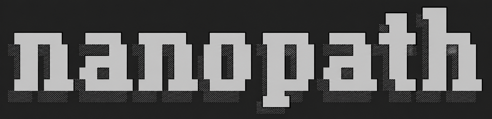
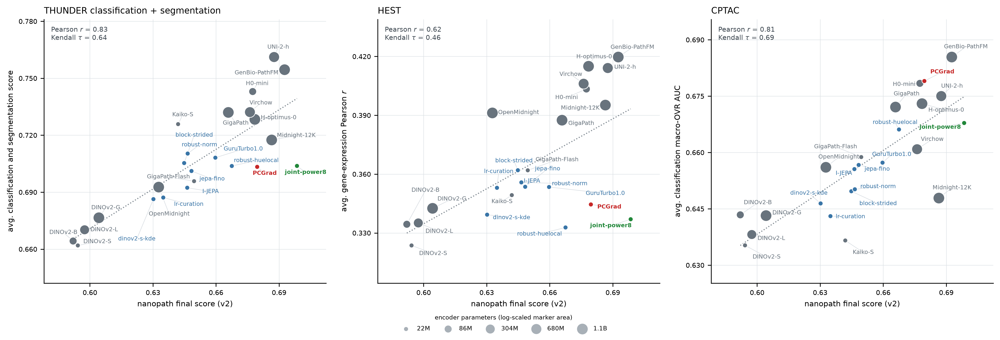
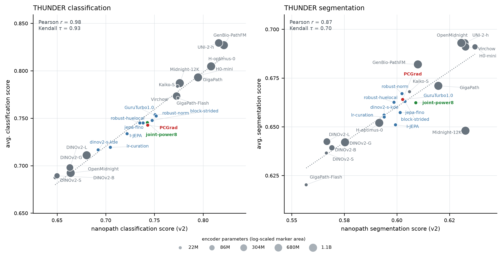

# nanopath



> **Nov 2026 update**: nanopath-evals v3 keeps the v2 datasets but fixes the readout: one forward pass per tile, final-layer CLS and patch tokens, no test-time augmentation or feature aggregation (see [what you must not change](#what-you-must-not-change-for-a-leaderboard-submission)). It also reweights `final_score` from 30/15/17.5/15/7.5/15 to 40/20/10/10/5/15. The Labless plot was reset to v3 and seeded by re-evaluating retained v2 checkpoints; the v2 and v1 plots are preserved but should not be hillclimbed on (v2 code can still submit from the [`main_v2`](https://github.com/MedARC-AI/nanopath/tree/main_v2) branch).

`nanopath` is a super lean experimental harness for training tile-level computational pathology foundation models, inspired by [nanochat](https://github.com/karpathy/nanochat). In ~1 hour it trains on 1 million pathology tiles on a single GPU and evaluates a broad suite of downstream probes spanning tile classification, segmentation, slide-level mutation/progression/survival, and robustness. The goal is to easily explore and iterate on research directions to see what works best on small-scale, then scale up the best performing training recipes with more data and larger compute.

This repository is intentionally made to be compatible with [autoresearch](https://github.com/karpathy/autoresearch)-style pursuits, and we even have a live autoresearch-style plot in [Leaderboard](#leaderboard). Nanopath models train until the next full batch would exceed the 1,000,000 tile-presentation cap or until the run reaches the 1e18-FLOP cap.

**Want to get involved? Join us in the [MedARC Discord](https://discord.gg/tVR4TWnRM9) (find us in #path-fm)!**

## stack4_salient_v3

[stack4_salient](https://github.com/MedARC-AI/nanopath/tree/stack4-salient) by [@RyanKim17920](https://github.com/RyanKim17920), ported to nanopath-evals v3, where a fresh run scores **0.6747** ([Labless run](https://labless.dev/runs/run_sub_46f7ab4a38); the three v2-validated checkpoints re-evaluate to 0.6722, 0.6736, 0.6765). Training is unchanged. The v2 readout (D4 test-time augmentation, fused last-four-block patch features, two-view CLS with MLP-activation concatenation, post-training scanner/site suppression and typicality gating) and its calibration pass are removed, so the probe reads the plain final-layer CLS and patch tokens. v2 results for the original readout are in the `stack4-salient` branch README.

The recipe, relative to `robust-huelocal` at `6c142b9` (including Benjamin Warner's Arrow loader, GPU augmentation, and runtime upgrades):

- Peak LR 0.000125 → 0.0002344; layerwise decay factor 0.7 → 0.8; KDE weight/concentration 0.1/10 → 0.0667/6.667. The original FLOP-based schedule stays unchanged.
- Four contiguous JEPA blocks are sampled using standardized teacher patch-to-CLS cosine similarity (temperature factor 1.5).
- Add 4096-prototype iBOT at weight 0.1 and local-to-global, overlap-aligned JEPA regression at weight 0.5, with a zero-initialized output layer.
- Sample slides uniformly, then tiles uniformly within each slide. Preserve crop scales, hue, and FINO from `robust-huelocal`.

The implementation uses torchvision crop sampling and batched mask sampling rather than the contributor's custom crop class and per-image mask loop. The cross-scale head lives in the existing JEPA predictor. All objective losses and gradient norm are logged separately.

Training stops after 7,671 optimizer steps (981,888 tile presentations): the 18,085 presentations `stack4-salient` spent on calibration stay unused so the trajectory matches the v2 runs.

## Quickstart

Install [uv](https://docs.astral.sh/uv/) first if you don't have it, then:

```bash
git clone --branch stack4_salient_v3 https://github.com/MedARC-AI/nanopath.git && cd nanopath
uv sync && source .venv/bin/activate
wandb login  # or: export WANDB_MODE=offline before launching noninteractive SLURM jobs

# Download prepared Arrow tiles, probe datasets, and model weights.
python prepare.py download=True

# smoke test: very short training, then probe evals to ensure no errors
./submit/train_1gpu.sbatch configs/smoke.yaml
# or directly on a GPU machine: python train.py configs/smoke.yaml

# train and evaluate the current nanopath recipe
# auto-submits to Labless if config passes submission requirements and you provide run name/notes & GitHub login
RUN_DIR=$PWD/data/main/my-run
./submit/train_1gpu.sbatch configs/main.yaml output_dir=$RUN_DIR
# or directly on a GPU machine: python train.py configs/main.yaml output_dir=$RUN_DIR
```

`pyproject.toml` requires Python 3.14 and pins PyTorch 2.14.0 and torchvision 0.29.0 from the CUDA 13.0 wheel index. By default `uv sync` installs Pillow-SIMD. For Apple Silicon, other ARM CPUs, or x86 CPUs without AVX2, see [Installation](#installation). If your GPU/driver needs a different CUDA build, update both package pins and their `[tool.uv.sources]` index in `pyproject.toml`, then run `uv sync`.

A successful model training prints periodic train lines, appends metrics to `metrics.jsonl`, and writes the final comparison artifact to `summary.json`. `configs/smoke.yaml` is simply meant to pretrain briefly and then run the fixed downstream probe suite to ensure everything works without errors.

W&B can run online or offline, but set that up before submitting a noninteractive job: either run `wandb login` once, or export `WANDB_MODE=offline`.

## Leaderboard

<a href="https://labless.dev/nano-projects/nanopath-v3">
  
</a>

`final_score` weights classification, segmentation, progression, mutation, survival, and CRoMa robustness at 40%, 20%, 10%, 10%, 5%, and 15%. These columns summarize a 20-dataset suite derived from [THUNDER](https://mics-lab.github.io/thunder/), [PathoBench](https://github.com/mahmoodlab/patho-bench), [LEOPARD](https://leopard.grand-challenge.org/), [PathoROB](https://arxiv.org/abs/2507.17845), and [CRoMa](https://github.com/clemsgrs/croma), with modifications to keep single-GPU evaluation lightweight and use train/validation-only data. See [benchmarking/README.md](benchmarking/README.md) for the full protocol and provenance caveats.

Nanopath models should be submitted to [Labless](https://labless.dev). `main` corresponds to this repository's main recipe. For promotion, [@PaulScotti](https://github.com/PaulScotti) retrains an unvalidated candidate three times with different randomly selected RNG seeds; its median run becomes the validated `leader` if it beats the incumbent by at least 0.004.





As you can see in the above correlation plots, our fast ~20 minute evaluation suite "nanopath-evals" used to calculate `final_score` strongly correlates to the much slower, official pathology foundation model benchmarks of THUNDER, HEST, and PathoBench. This suggests nanopath hillclimbing should reflect useful, generalizable improvements.

### nanopath models

The `main` branch uses the `lr-and-curation` recipe. `main` and stack4_salient were retrained under v3; the other scores are v3 re-evaluations of each model's validated v2 checkpoint. Only `main` and `stack4_salient_v3` are ported to v3; the other links are v2-era recipe branches.

| # | Description | final score | classification | segmentation | progression | mutation | survival | robustness | Contributors |
|---|---|---:|---:|---:|---:|---:|---:|---:|---|
| 1 | [stack4_salient](https://github.com/MedARC-AI/nanopath/tree/stack4_salient_v3) | **0.6747** | 0.7505 | 0.6067 | 0.6170 | 0.6266 | 0.6525 | 0.6416 | [@RyanKim17920](https://github.com/RyanKim17920) |
| 2 | [robust-huelocal](https://github.com/MedARC-AI/nanopath/tree/robust-huelocal) | 0.6660 | 0.7423 | 0.5981 | 0.6511 | 0.6288 | 0.6179 | 0.6038 | [@anishdulal](https://github.com/anishdulal) |
| 3 | [GuruTurbo1.0](https://github.com/MedARC-AI/nanopath/tree/GuruTurbo1.0) | 0.6652 | 0.7449 | 0.6027 | 0.6111 | 0.6296 | 0.6326 | 0.6069 | [@aajing](https://github.com/aajing) |
| 4 | [jepa-fino](https://github.com/MedARC-AI/nanopath/tree/jepa-fino-v2) | 0.6648 | 0.7383 | 0.6024 | 0.6010 | 0.6194 | 0.6215 | 0.6392 | [@ml-and-ml](https://github.com/ml-and-ml) |
| 5 | block-strided-cls | 0.6619 | 0.7362 | 0.5963 | 0.6047 | 0.6056 | 0.6376 | 0.6353 | @RyanKim17920 |
| 6 | [robust-norm](https://github.com/MedARC-AI/nanopath/tree/robust-norm-v2) | 0.6590 | 0.7387 | 0.5968 | 0.6351 | 0.5915 | 0.6115 | 0.6064 | [@anishdulal](https://github.com/anishdulal) |
| 7 | [pathway-tta](https://github.com/MedARC-AI/nanopath/tree/pathway-tta) | 0.6564 | 0.7395 | 0.5988 | 0.6214 | 0.6060 | 0.6086 | 0.5846 | [@achi2023](https://github.com/achi2023) |
| 8 | I-JEPA contig patch | 0.6562 | 0.7218 | 0.5877 | 0.6238 | 0.6151 | 0.6173 | 0.6342 | @NimaAsh |
| 9 | [lr-and-curation](https://github.com/MedARC-AI/nanopath) | 0.6425 | 0.7019 | 0.5977 | 0.5747 | 0.6009 | 0.6414 | 0.6168 | @nevasini1 |

The robust-huelocal, GuruTurbo1.0, and pathway-tta rows are the median-seed checkpoints of their three-seed v2 validations; stack4_salient is retrained with its median seed.

### Baselines

| # | Name | Description | final score | classification | segmentation | progression | mutation | survival | robustness |
|---|---|---|---:|---:|---:|---:|---:|---:|---:|
| 1 | GenBio-PathFM | GenBio-PathFM ViT-G/16 | **0.7085** | 0.8213 | 0.6100 | 0.6630 | 0.6232 | 0.6312 | 0.6518 |
| 2 | UNI-2-h | MahmoodLab UNI-2-h ViT-H/14 | 0.7014 | 0.8161 | 0.6323 | 0.6771 | 0.6408 | 0.6105 | 0.5745 |
| 3 | Midnight-12K | Kaiko Midnight-12K ViT-G/14 | 0.6996 | 0.7761 | 0.6326 | 0.6669 | 0.6170 | 0.6100 | 0.6918 |
| 4 | H0-mini | Bioptimus H0-mini ViT-B/14-reg | 0.6960 | 0.7956 | 0.6371 | 0.6387 | 0.6026 | 0.5945 | 0.6429 |
| 5 | Virchow | Paige/Microsoft Virchow ViT-H/14 | 0.6897 | 0.7728 | 0.6326 | 0.6460 | 0.6291 | 0.6173 | 0.6379 |
| 6 | H-optimus-0 | H-optimus-0 ViT-G/14-reg | 0.6897 | 0.8082 | 0.5916 | 0.6683 | 0.6485 | 0.6059 | 0.5737 |
| 7 | GigaPath | Prov-GigaPath tile encoder ViT-G/16 | 0.6797 | 0.7948 | 0.6197 | 0.6663 | 0.6130 | 0.5802 | 0.5391 |
| 8 | Kaiko-S/16 | Kaiko pathology ViT-S/16 | 0.6619 | 0.7737 | 0.6060 | 0.6025 | 0.5539 | 0.5907 | 0.5735 |
| 9 | GigaPath-Flash | Prov-GigaPath-Flash tile encoder ViT-S/16 | 0.6579 | 0.7742 | 0.5569 | 0.6592 | 0.5796 | 0.6122 | 0.5493 |
| 10 | OpenMidnight | OpenMidnight ViT-G/14-reg | 0.6356 | 0.6640 | 0.6306 | 0.6435 | 0.5829 | 0.6058 | 0.6062 |
| 11 | DINOv2-G/14 | Meta DINOv2-G/14-reg | 0.6143 | 0.6804 | 0.5753 | 0.5320 | 0.6038 | 0.6288 | 0.5469 |
| 12 | DINOv2-L/14 | Meta DINOv2-L/14-reg | 0.6050 | 0.6632 | 0.5667 | 0.5445 | 0.6005 | 0.6009 | 0.5454 |
| 13 | DINOv2-S/14 | Meta DINOv2-S/14-reg | 0.6006 | 0.6480 | 0.5665 | 0.5352 | 0.6202 | 0.6220 | 0.5430 |
| 14 | DINOv2-B/14 | Meta DINOv2-B/14-reg | 0.5993 | 0.6500 | 0.5691 | 0.5364 | 0.6062 | 0.6015 | 0.5408 |

Baseline rows are frozen reference checkpoints evaluated with the same probe suite. They help calibrate the plot, but pathology-specific baselines are not valid initialization points for nanopath leaderboard submissions. The reference scripts live in `baselines/`.

### How to submit to the leaderboard

Labless is our public run ledger and live plot for `nanopath`. You do not need a Labless password or a pull request to make a leaderboard claim; the submitter connects your submission to your GitHub identity through GitHub's device sign-in. We encourage you to submit *all* completed full runs, including null results and incremental tweaks; a dense public ledger lets you (and AI agents, see our [public ledger API](https://labless.dev/docs/ledger-api)) mine through everyones runs to uncover new insights.

See [labless/README.md](labless/README.md) for Labless submission details and public API usage.

`configs/main.yaml` is the current nanopath training recipe. A normal SLURM submission is:

```bash
RUN_DIR=$PWD/data/main/my-run
./submit/train_1gpu.sbatch configs/main.yaml output_dir=$RUN_DIR
```

The pipeline is:

1. Run `./submit/train_1gpu.sbatch ...` or `python train.py ...` to start your training run. For full runs, the launcher asks for a short `run_name`, an optional experiment note naming the unique change and why, and GitHub device sign-in before scheduling the GPU job. Leaving the run name blank or failing to sign in will lead to skipping labless submission.
2. Let `train.py` finish the final probe. The run directory will contain `summary.json`, `metrics.jsonl`, and the source snapshot written at launch under `labless_source/`. The submitter writes `labless_submission.json`, checks the run caps and locked benchmark surface, posts to `api.labless.dev`, and shows the run as `unvalidated` until maintainer validation.

Manual submission is still available for direct `python train.py` runs or copied output directories:

```bash
./labless/submit_to_labless.py output_dir=$RUN_DIR run_name=kde-crops notes="vs main: larger local crops to retain tissue context"
```

Public full-run submissions must satisfy:

- `summary.max_train_samples == 1000000`
- `summary.tile_presentations <= 1000000`
- `summary.max_train_flops == 1e18`
- `final_score` is present
- no saved-source changes to `probe.py` or anything under `benchmarking/`
- no locked probe config changes except local `probe.dataset_roots`

The `run_name` is the short label shown next to your dot on the Labless plot; keep it under 20 characters and make it describe what changed. Short smoke-sized runs, failed runs, and runs missing the saved source snapshot stay local. Each verified GitHub login can submit at most 100 runs per 24 hours.

Public submissions have no wall-clock limit. Each maintainer reproduction must train within 2 hours. **You don't need an H100 or a PR to submit**; Labless handles the public record and maintainer validation.

Code-cleanup PRs are still welcome when they simplify the codebase without changing benchmark performance on the main recipe. Leaderboard claims should go through Labless instead of a pull request.

### What you must NOT change for a leaderboard submission

Anything not explicitly fixed below (e.g., model architecture, training objective, optimizer, lr scheduler, data augmentations, masking, dataset curation) is fair game for modification.

**Training ends at 1,000,000 tile-presentation samples OR 1e18 total FLOPs**

Every leaderboard run is bounded by two possible caps:

- **`train.max_train_samples` ≤ 1,000,000 tile presentations**. A training sample is one source TCGA tile emitted as one dataloader item; if the same underlying tile is seen again later, that is another tile presentation. Teacher/student views, global/local crops, masks, or other augmentations derived from that tile do not multiply the sample count, though their compute still counts toward FLOPs. `train.py` never starts a batch that would push `summary.tile_presentations` over the cap.
- **`train.max_train_flops` ≤ 1e18 training FLOPs**, measured directly via `torch.utils.flop_counter.FlopCounterMode` on the first step (forward + backward + optimizer.step) and reused thereafter since per-step shapes are fixed. This counts everything that touches the GPU during a step (student backbone, EMA teacher forward, projection heads, masking, etc.).

LR decay, weight decay, teacher-temperature, freeze, and KDE schedules are keyed to `train_flops / train.max_train_flops`; LR warmup is keyed to tile presentations so it finishes early in the 1,000,000-tile sample-capped run. The `main` recipe normally reaches the sample cap at about 19% of the 1e18-FLOP budget, so the FLOP-keyed schedules intentionally stop early unless you change the caps or schedule fractions.

Wall time is logged for diagnostics and standardized reruns, but it is not a public-submission eligibility cap. Maintainer validation is separate: the submitted recipe must complete training on the maintainer's single 80 GB H100 within 2 hours.
Intensive preprocessing before model training starts, such as tile extraction, data curation, metadata joins, indexing, or embedding generation, is allowed and is not counted as training time.

**TCGA as the only tile source**
- Every image tile used for training must be produced exclusively from the 12K TCGA WSIs. You can change tile extraction, filtering, sampling, curation, and preprocessing before the capped model-training run begins.
- Public non-tile information is fair game: metadata, clinical/genomic labels, text, ontologies, annotations, or other non-image-tile signals from any public source may be used however you want.

**Probe evaluation and readout must be untouched**
- All of `probe.py` and `benchmarking/`.
- All probe config variables in `configs/main.yaml`.
- The readout. The probe calls `model(x)` once per tile in eval mode and reads only `cls` (classification, slide and CRoMa probes) and `patches` (segmentation). That forward must be the same single pass the pretraining loss trained: final layer only, `embed_dim` wide, no extra views or passes, no eval-only branches, no statistics fitted after training, and nothing conditioned on the dataset or task. `probe.py` asserts single-pass execution, output shapes, and train/eval equality before probing; a run that passes the asserts but breaks this rule is marked invalid. The rest of `model.py` is yours to change.

**Pretraining must not use pathology-specific pretrained models**
Non-pathology pretrained models such as DINOv2 may be used for initialization, teachers, data curation, or preprocessing. Pathology-trained checkpoints such as H-optimus-0 or OpenMidnight may not initialize weights or guide training, but they may be used before and separately from training for TCGA-tile curation or preprocessing.

## Repository layout

### Primary files meant to be hacked
- `train.py` — main pretraining loop
- `model.py` — model architecture and training objectives
- `dataloader.py` — TCGA tile loader and data augmentations
- `configs/{smoke,main}.yaml` — training recipes (e.g., hyperparameters)

### Helper files
- `AGENTS.md` — guidelines for design philosophy, coding rules, experiment discipline, cluster conventions, etc. Note this is Paul's personal `AGENTS.md` file and has instructions specific to our MedARC cluster—you should modify this file to suit your own setup!
- `benchmarking/` — dataset/protocol documentation.
- `prepare.py` — data prep: verify or download pretraining data + probe datasets + any pretrained weights.
- `probe.py` — downstream probes (KNN, few-shot, linear, segmentation, slide AUROC, survival, robustness).
- `submit/train_1gpu.sbatch` — SLURM launcher for single-GPU training.
- `labless/submit_to_labless.py` — package a run and post it to the live labless tracker.
- `download_TCGA.sh` — manual utility, run by hand if you want the full 12K TCGA open-access SVS slide set (~13 TB) for forking the tile-extraction recipe. Not invoked by `prepare.py` and not needed for any standard training workflow.
- `pyproject.toml` + `uv.lock` — Python dependencies used by `uv sync`.

## Data

`prepare.py` prepares the necessary data for pretraining and downstream probing. By default it reads `configs/main.yaml`; pass a YAML path before the flag to prepare a different config, e.g. `python prepare.py configs/smoke.yaml download=True`. Flag `download=True` to fetch/prepare the configured datasets into the folders specified by the YAML; flag `download=False` to verify that all required paths are already populated.

On the MedARC cluster, the checked-in `/data` paths are the intended shared defaults and existing populated roots are reused. On a machine without writable `/data` or `/block` mounts, `download=True` rewrites the checked-in main and smoke configs to ignored repo-local `data/` roots before downloading.

**What `download=True` does**

1. **TCGA tiles**: `huggingface_hub.snapshot_download` fetches the 200 prepared Arrow shards (~120 GB) from [`medarc/nanopath`](https://huggingface.co/datasets/medarc/nanopath) into `data.dataset_dir`. Downloads include only `shard-*.arrow`. Each row contains `path`, original `jpeg` bytes, and cached `tissue_fraction`. FINO patient metadata is also fetched and verified in this directory.
2. **Probe datasets**: downloads the exact evaluation snapshot from [`medarc/nanopath-evals`](https://huggingface.co/datasets/medarc/nanopath-evals) into each missing configured root, then verifies every required record.
3. **DINOv2 backbone weights**: `torch.hub.load_state_dict_from_url` fetches the Meta checkpoint for `model.type` from `dl.fbaipublicfiles.com` into `~/.cache/torch/hub/checkpoints/`.

**Prerequisites**

- About 335 GB for prepared data: 120 GB of Arrow tiles and 215 GB of probe data. Archive extraction needs additional temporary space. Raw-slide regeneration needs separate storage for slides and intermediate JPEGs.
- Acceptance of each upstream benchmark dataset's original research-use terms. The MedARC mirror preserves the data needed by the protocol but does not relicense its components.

Our evaluation suite only downloads a small subset of non-test data derived from [THUNDER](https://mics-lab.github.io/thunder/), [PathoBench](https://github.com/mahmoodlab/patho-bench), [LEOPARD](https://leopard.grand-challenge.org/), and [PathoROB](https://arxiv.org/abs/2507.17845). It contains no official THUNDER, HEST, or CPTAC classification test records; HEST is absent entirely, CPTAC appears only in the existing CPTAC-PDA survival development probe, PanNuke Fold3 is absent, and the unused TCGA center is removed from downloadable Tolkach ESCA. See [benchmarking/README.md](benchmarking/README.md) for the precise split contract.

### Regenerating the tile dataset from raw SVS

`prepare.py` itself never touches raw SVS files—it always pulls the ready-made Arrow shards from Hugging Face. If you want, however, you can download the full ~13 TB original SVS files from TCGA and pre-extract different tiles to pretrain on. Two-step workflow (decode SVS → JPEG dir + manifest, then pack into Arrow shards):

```bash
# 1) Download the full 12K open-access TCGA SVS slide set (~13 TB).
bash download_TCGA.sh /data/TCGA 8

# 2) Decode + pack. prepare_tiles deterministically subsamples the sample list
#    to TARGET_TILE_COUNT (4M, hardcoded in prepare.py — bump it for a bigger
#    dataset) and writes JPEGs + manifest.txt under jpeg_dir; reruns are
#    resumable (existing JPEGs are EOF-validated and reused). pack_from_jpeg_dir
#    then walks the manifest, splits into NUM_SHARDS=200 chunks, and writes
#    shard-NNNNN.arrow files with one record batch per shard.
python -c "
from pathlib import Path
from prepare import prepare_tiles, pack_from_jpeg_dir
jpeg_dir = Path('/data/$USER/nanopath/nanopath_jpegs_tmp')
prepare_tiles(Path('/data/TCGA/sample_dataset_30.txt'), jpeg_dir, split_seed=42)
pack_from_jpeg_dir(jpeg_dir, jpeg_dir / 'manifest.txt', Path('/data/nanopath_arrow'))
"
```

Packing computes tissue fractions from the saved JPEG bytes and includes the required metadata.
Point `data.dataset_dir` in both configs at the packed Arrow directory before training.

## Running on SLURM

`submit/train_1gpu.sbatch` is a prompt-aware launcher when run directly: it collects Labless run name, notes, and GitHub device login before submitting itself to SLURM, then auto-submits eligible completed full runs. Calling `sbatch submit/train_1gpu.sbatch ...` bypasses that prompt and trains without auto-submit. `configs/main.yaml` is sized for an 80 GB H100 at `train.batch_size: 128`. On smaller cards you can set `train.activation_checkpointing: true` and lower `train.batch_size` if you OOM.

The checked-in `#SBATCH` lines are specific to our MedARC cluster. On another SLURM cluster, edit those header lines once to match your queue, or run `python train.py ...` directly on an allocated GPU.

## Installation

Pillow-SIMD requires an x86 CPU with AVX2 and libjpeg, zlib, and libtiff development headers and libraries.

On Apple Silicon, other ARM CPUs, or x86 CPUs without AVX2, exclude Pillow-SIMD with the following install command:

```bash
uv sync --no-group simd --group pillow
```

## Outputs

`prepare.py … download=True` reads `configs/main.yaml` by default and checks every path train.py will read, downloading data if specified config paths are missing.

- run outputs: `project.output_dir` (MedARC cluster default `/data/$USER/nanopath/main/...`; auto-localized default `nanopath/data/main/...`). Final probe results log to `metrics.jsonl`.
- wandb: `project.wandb_dir` (cluster default `/data/$USER/nanopath/wandb`; auto-localized default `nanopath/data/wandb`).
- Arrow tile shards: `data.dataset_dir` (defaults to `/data/nanopath_arrow`).
- probe datasets: canonical shared `/data/thunder-data`, `/data/surgen`, `/data/leopard_bcr`, `/data/CPTAC-PDA`, `/data/pathorob`, and `/data/ucla-lung` roots declared in `probe.dataset_roots`.
- DINOv2 backbone weights: `~/.cache/torch/hub/checkpoints/` for the selected `model.type`.
- SLURM logs: `slurm/<jobid>.{out,err}` in the repo.
- labless source snapshot: `project.output_dir/labless_source`.
- labless submission payload: `project.output_dir/labless_submission.json`.
- labless auto-submit token: `${project.output_dir}.labless_autosubmit.json` while a prompt-armed SLURM job is running; the launcher removes it after the post-run submission attempt.
- checkpoints: rolling `latest.pt` written every `train.save_every` steps under `project.output_dir`, plus one final save at end of run. `save_every: null` (smoke) disables both; probes always get their own short-lived checkpoint regardless.

## Acknowledgements

Inspired by [nanochat](https://github.com/karpathy/nanochat). The DINOv2 backbone weights are [Meta checkpoints](https://github.com/facebookresearch/dinov2) loaded by state-dict into our own clean ViT implementation. Tile-classification and segmentation probes follow the [THUNDER benchmark](https://mics-lab.github.io/thunder/); slide-level probes follow [PathoBench](https://huggingface.co/datasets/MahmoodLab/Patho-Bench) and LEOPARD.
